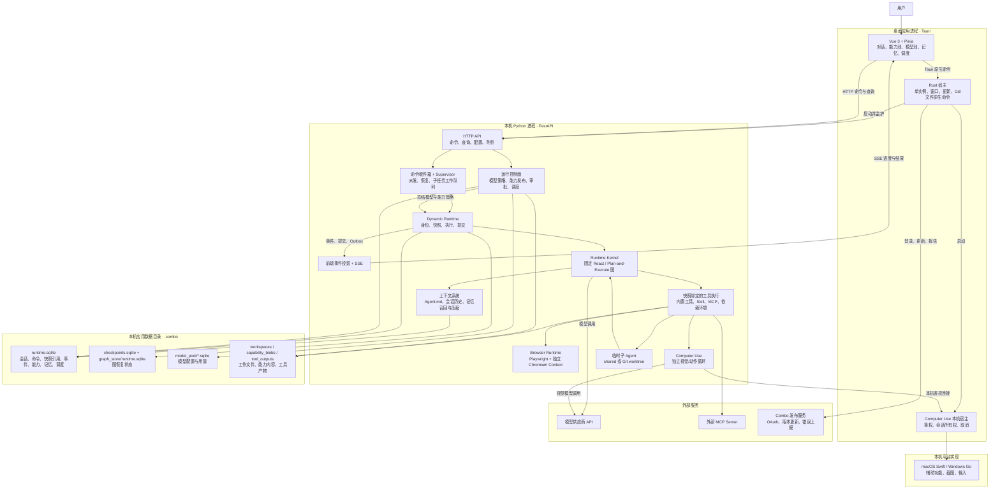
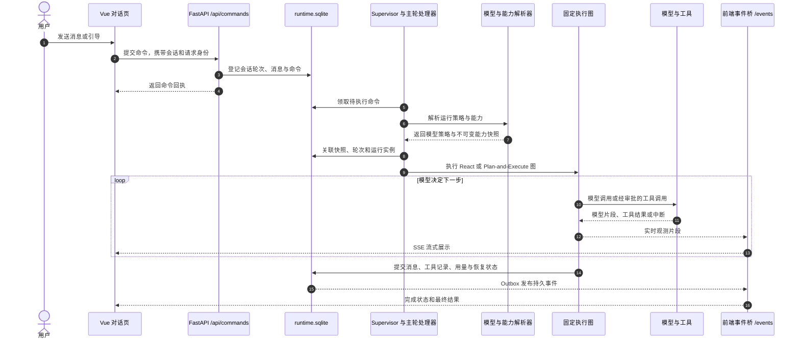

# Combo 当前架构

基于 2026-09-28 仓库实现。实线表示主要调用或数据流；图中的「工作区隔离」是应用层边界，不代表操作系统沙箱。

## 系统组成

## 一轮对话的执行与回显

## 边界与职责

| 边界 | 当前实现 |
| --- | --- |
| 桌面与后端 | Rust 启动 Python sidecar；Vue 直接经本机 HTTP 调 FastAPI，并从 SSE 接收事件。Rust 负责原生能力，不承载 Agent 图。 |
| 请求与执行 | 命令先进入持久化收件箱；Supervisor 派发主请求与临时子任务。每轮固定模型策略、能力快照和运行身份。 |
| 模型与上下文 | 模型池提供 Profile/凭据；上下文系统组装 Agent.md、会话历史和当前范围的记忆，按需检索与压缩。知识库通过独立检索能力使用。 |
| 工具与资源 | 工具注册表由该轮能力快照物化；文件/进程绑定工作区，浏览器按 Agent 会话隔离 Context；Computer Use 经本机宿主调用平台实现。 |
| 子 Agent | 临时运行实例复用固定图；`shared` 使用主工作区，`worktree` 从 Git HEAD 创建独立工作树和本地分支，集成由主 Agent 决定。 |
| 落盘与恢复 | `runtime.sqlite` 保存业务与执行账本；LangGraph checkpoint/graph store 保存图恢复状态；模型池和文件产物分别存放。Outbox 将持久事件投影到前端。 |
| 云端服务 | `services/combo_service` 处理官网、桌面 OAuth、发布更新和错误上报；不承担本地 Agent 运行或能力发布。 |

关键源码入口：[Tauri 主进程](../src-tauri/src/main.rs)、[FastAPI 装配](../web_frontend/backend/event_api_server.py)、[后端组合根](../web_frontend/backend/runtime_backend.py)、[运行时组合根](../combo/dynamic_runtime/application.py)、[单轮命令处理](../combo/dynamic_runtime/main_turn.py)、[固定执行图](../combo/runtime_kernel/fixed_graphs.py)、[工具快照](../combo/dynamic_runtime/snapshot_tool_registry.py)、[事件投影](../web_frontend/backend/frontend_event_bridge.py)。
